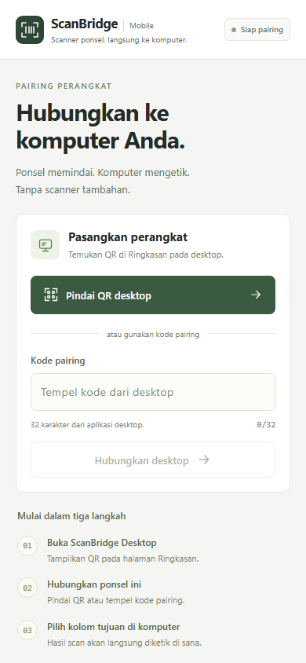
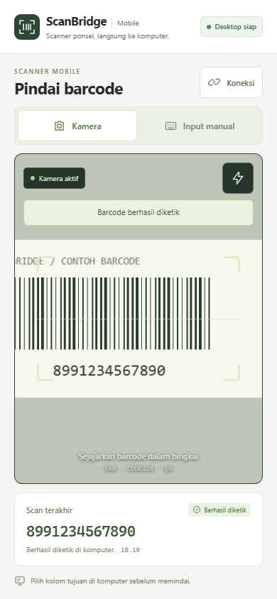

# Mobile design aligned with desktop 0.1.5

The mobile interface uses the desktop's `#f5f6f3` canvas, white cards, dark green actions, scanner mark, system typography, and monospaced barcode values. PWA theme colors and maskable PNG icons come from the same SVG mark in `public/icons/mark.svg`.

Screenshots use simulated camera content and example barcode data. They contain no customer scans or live pairing credentials.

## Behavior

- Pairing prioritizes scanning the desktop QR. The visible manual field accepts a pasted formatted code or pairing URL, validates hexadecimal characters, and does not automatically open the keyboard.
- Desktop confirmation is required before opening the scanner. Desktop readiness and camera activity have separate indicators.
- Camera and manual input are separate modes. Switching to manual stops the camera. Permission errors and the 10-second battery-saving pause provide explicit recovery actions; a camera retry starts a fresh attempt and idle deadline.
- The last scan shows pending, successfully typed, or error states. Successful delivery is shown only after the desktop acknowledgement. A pending camera send prevents an additional camera submission until it settles.
- A missing acknowledgement tells users to inspect the destination before retrying. Oversized barcodes are rejected locally using the desktop's 256-character limit, without incorrectly disconnecting a healthy desktop.
- Connection controls live in a native dialog with the pairing code, reconnect, and a confirmed reset. Opening connection/reset dialogs pauses camera access.
- Pairing survives transient loss of connection. Privacy copy explicitly explains that desktop settings control scan history.

## Validation

The mobile build runs TypeScript checks. Session tests cover acknowledgement states, connection recovery, reset behavior, local length validation, and Unicode character counts; existing desktop/realtime and contract tests remain unchanged in behavior.

Fifteen browser scenarios exercise the real React UI and scanner hook with simulated realtime and decoder/media objects. They cover formatted paste, desktop confirmation, pending scan suppression, acknowledgement failures, torch constraints, manual mode, modal focus, cancellation/reset, desktop loss/reconnect, installation, camera retry, QR validation, idle pause/resume, and missing configuration. Layouts are checked at 320 × 568, 360 × 640, 390 × 844, 768 × 1024, and 844 × 390.
